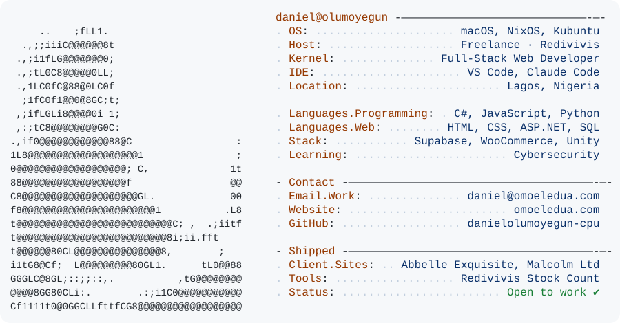

<a href="https://omoeledua.com">
  <picture>
    <source media="(prefers-color-scheme: dark)" srcset="dark_mode.svg">
    
  </picture>
</a>

  
  

### 👋🏾 Hey, I'm Daniel

Full-stack web developer in **Lagos, Nigeria**. I build fast, clean websites and web apps for real clients, from e-commerce stores to internal tools. By day I also work on device processing and automation at Redivivis, and I'm currently levelling up in **cybersecurity**.

### 🚀 Featured Work

| Project | What it is | Stack | Link |
|---|---|---|---|
| **Abbelle Exquisite** | Luxury fashion e-commerce store: catalog, cart, checkout and admin | HTML · CSS · C# · ASP.NET | [abbelleexquisite.biz](https://abbelleexquisite.biz) |
| **Malcolm Ltd** | Multi-page marketing agency site built from a design mockup | HTML · CSS · JS | [repo](https://github.com/danielolumoyegun-cpu/malcolm-ltd) |
| **Redivivis Stock Count** | Installable stock-count web app for Redivivis inventory | HTML · JS · PWA | [repo](https://github.com/danielolumoyegun-cpu/Redivivis-Stock-) |
| **D.O.O** | My personal portfolio site | HTML · CSS · JS | [omoeledua.com](https://omoeledua.com) |

### 🛠️ In the Lab

- **NaijaLove** — Nigerian-themed dating app with a Supabase backend and multi-agent AI
- **SchoolGuard** — parent notification app with SMS/WhatsApp alerts and NDPR-compliant security
- **RenalDesk** — multi-tenant dialysis centre management SaaS (Supabase / PostgreSQL)
- **Naija Rush** — 3D endless-runner mobile game through the streets of Lagos (Unity · C#)

### 🧰 Toolbox

---

<i>Available for freelance web projects — let's build something.</i>

